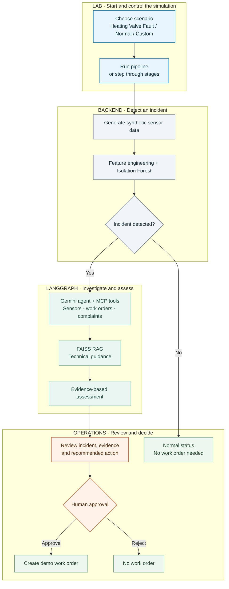

# PropertyOps AI Investigator

**From scattered building data to an evidence-based maintenance recommendation, with a person making the final decision.**

I built PropertyOps as an independent, full-stack AI project to explore how anomaly detection and AI agents can support HVAC fault investigations. Instead of checking sensor readings, maintenance history, tenant complaints, and technical documents separately, the application brings that evidence into one workflow.

**[🚀 Try the live demo](https://ca-propertyops-ai.bravemeadow-1c7ef3e7.northeurope.azurecontainerapps.io/operations)** · **[📊 Explore the project presentation](https://propertyops-ai-presentation.sajad-amouei.workers.dev/)**

## Start here: the demo has two tabs

**This is an interactive simulation, not a live building-monitoring system.** It does not start investigating on its own. **Start in the Lab** to run a scenario; **Operations** then shows what the system found and what action it recommends. Seeing **“No active investigation”** in Operations before a run is expected.

| Tab | What it's for |
| --- | --- |
| **Lab** | Control the simulation: choose a fault scenario, run the pipeline, and inspect each step's inputs, outputs, and charts. |
| **Operations** | See the operational view: incident details, sensor trends, evidence, AI assessment, and the work-order approval decision. |

### Try it in a few steps

1. Open **[Lab](https://ca-propertyops-ai.bravemeadow-1c7ef3e7.northeurope.azurecontainerapps.io/lab)**, keep **Heating Valve Fault** selected, and click **Run full pipeline**. You can also use **Run next step** to follow the process in detail.
2. The investigation runs until **Human Approval**. Click a pipeline stage in Lab to inspect its **Overview**, **Inputs**, **Outputs**, or **Visuals**.
3. Switch to **Operations** to review the incident and recommendation. **Approve** or **reject** the proposed *demo* work order; the decision is reflected in the workflow.
4. To change the behavior, return to Lab, choose **Normal Operation** (no incident or work order expected) or **Custom Fault** (choose a sensor and fault injection), then run it again.

## How it works



The ML pipeline detects unusual operating patterns. If it finds an incident, a **Gemini-powered agent** gathers evidence through **MCP tools**; **RAG** retrieves relevant troubleshooting guidance; and **LangGraph** coordinates the assessment and pauses before any write action. A work order is created only after explicit approval.

## What is simulated, and why?

**No real building systems or maintenance platforms are connected.** The project uses small, reproducible scenarios so anyone can safely test both normal and faulty behavior.

- **Sensor telemetry:** Python, NumPy, and pandas generate readings based on occupancy schedules and seeded randomness. The Lab can inject spikes, offsets, stuck values, multipliers, or missing readings.
- **Operational systems:** CSV datasets stand in for equipment/sensor inventories, maintenance work orders, and tenant complaints. An **MCP server** provides tools to query them, simulating access to separate building-management and maintenance systems.
- **Technical knowledge:** Purpose-written Markdown troubleshooting guides are retrieved with **Sentence Transformers + FAISS**. Approved work orders are recorded only within the demo environment.

This setup makes the same fault reproducible, supports automated tests, and avoids using private facility data or triggering real maintenance actions.

## Engineering challenges addressed

- **Fragmented context:** Combine telemetry, maintenance records, complaints, and guidance into one investigation rather than manual cross-checking.
- **Grounded AI decisions:** Trace MCP tool calls and distinguish measured evidence from likely causes, so the AI gives a hypothesis rather than claiming a confirmed diagnosis.
- **Safe, recoverable workflows:** Use persistent LangGraph checkpoints, an explicit approval gate, and idempotent work-order creation.
- **End-to-end reliability:** Connect the ML pipeline to a usable frontend, test it with pytest and Playwright, and deploy it through GitHub Actions to Azure Container Apps.

## Tech stack

**AI / ML:** Python, scikit-learn (Isolation Forest), Gemini, LangChain, LangGraph, MCP, Sentence Transformers, FAISS  
**App:** FastAPI, React, TypeScript, Recharts, SQLite checkpoints  
**Testing / deployment:** pytest, Playwright, Docker, GitHub Actions, Azure Container Apps

## Run locally

Create a `.env` file in the project root with `GOOGLE_API_KEY=your_key`, then run:

```bash
docker compose up --build
```

Open **http://localhost:3000**. The initial run may download the embedding model.

> **Portfolio demo:** All operational records are simulated. AI assessments are suggestions for human review, not confirmed diagnoses; the application does not control physical equipment.
